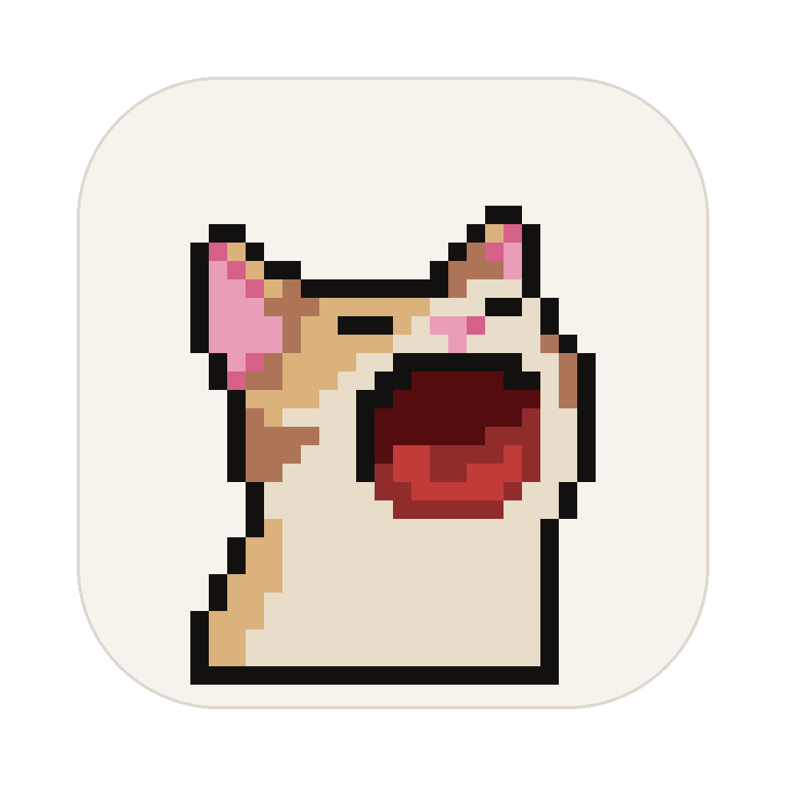

<p align="center"></p>

<h1 align="center">PixelPet</h1>
<p align="center">바탕화면에 사는 픽셀 고양이와 함께 친구들이랑 채팅해요 🐾</p>

---

## 📦 설치 (Mac)

### 1. 파일 받기
**[Releases](../../releases/latest)**에 가서 내 맥에 맞는 파일을 받아요.

- **애플 칩 맥 (M1/M2/M3/M4)**: `PixelPet-x.x.x-arm64.dmg`
- **인텔 맥**: `PixelPet-x.x.x.dmg`
- 잘 모르겠으면 왼쪽 위  → "이 Mac에 관하여"를 열어 보세요. "칩"이 Apple로 시작하면 arm64예요.

### 2. 설치하기
1. dmg를 열고 PixelPet을 **응용 프로그램** 폴더로 끌어다 놓아요.
2. 응용 프로그램 폴더에서 PixelPet을 열어요. 처음 한 번은 **"확인할 수 없음"** 경고가 떠요. 애플 개발자 인증을 받지 않은 앱이라서 그래요. **완료**를 눌러 창을 닫아요.
3. **시스템 설정 → 개인정보 보호 및 보안**을 열고 아래로 내려서 PixelPet 옆의 **"그래도 열기"**를 눌러요. 맥 비밀번호를 넣으면 열려요.
4. 다음부터는 그냥 열려요.

> **"손상되었기 때문에 열 수 없습니다"가 뜨면**
> 휴지통으로 이동은 누르지 말고 **취소**를 눌러요. 그다음 터미널(`⌘ + Space` → "터미널")을 열고 아래 명령을 붙여 넣은 뒤 Enter를 눌러요.
> ```bash
> xattr -cr /Applications/PixelPet.app
> ```
> 0.1.0 버전에서 생기던 문제예요. 0.1.1부터는 고쳐졌어요.

### 3. 시작하기
1. 닉네임을 넣고 내 고양이를 골라요.
2. 첫 번째 방 이름을 정하고, 친구에게 받은 **방 코드**를 넣어요. 내가 방을 만들 때는 "새 방 만들기"를 눌러요.
3. 화면 아래쪽에 고양이가 나타나요. **고양이를 클릭하면 그 방 채팅창**이 열려요.

## 🐱 사용법

- 바탕화면에는 **고른 방 하나의 고양이**만 앉아 있어요. 이름표에 내가 정한 방 이름이 보여요.
  - 바꾸려면 채팅창 **⋯ → 바탕화면에 이 방 고양이 보이기** 또는 메뉴 막대 **🐾 → 바탕화면 고양이**
- 친구가 메시지를 보내면 고양이가 잠깐 걸어다니고, 머리 위에 **"메시지가 왔다냥"**이 떠요. 다른 방에 온 메시지는 **"회사동기에 메시지가 왔다냥"**처럼 방 이름이 붙어요. 내용은 채팅창에서 봐요.
- 말풍선을 누르면 메시지가 온 방이, 고양이를 누르면 고양이의 방이 열려요.
- 알림은 **x**로 닫을 수 있어요. 빨간 숫자는 **모든 방의 안 읽은 개수**이고, 채팅창에서 읽을 때까지 남아요.
- 채팅창 위쪽 **+**: 방 추가
- 채팅창 오른쪽 위 **⋯**: 방 이름·고양이 바꾸기, 방 코드 복사, 방 나가기
- 방 이름과 방 고양이는 **내 화면에서만** 보여요.
- 고양이는 흰냥이, 삼색이, 치즈냥이, 고등어, 샴, 까망이 6종이 있어요.

### 메뉴 막대 🐾
화면 오른쪽 위의 🐾를 누르면 펫 숨기기, 채팅 열기, 바탕화면 고양이 고르기, 방 코드 복사, 닉네임·내 고양이 바꾸기, 종료를 할 수 있어요.

- 🐾가 안 보이면 메뉴 막대 아이콘이 많아서 노치 뒤에 숨은 거예요. `⌘`를 누른 채 안 쓰는 아이콘을 끌어서 빼 주세요.
- 회의할 때는 **`Ctrl + Option + P`**로 펫을 잠깐 숨겨요. 한 번 더 누르면 다시 나와요.

## 🔒 알아두기

- 대화는 **방 코드로 암호화**돼요. 방 코드는 아는 사람끼리만 나눠 주세요.
- 메시지는 서버에 저장되지 않아요. **앱이 꺼져 있을 때 온 메시지는 받을 수 없어요.** 내 PC에는 방마다 최근 200개까지 남아요.

---

## 🛠 개발

```bash
npm install
npm start          # 실행
npm run dist       # Mac 설치 파일(dmg) 만들기 → dist/
```

한 PC에서 두 명을 테스트하려면 이렇게 실행해요.

```bash
PIXELPET_PROFILE=friend npm start
```

- 실시간 통신: 공개 MQTT 중계 서버(EMQX, HiveMQ)에 동시에 연결하고, 메시지는 AES-256-GCM으로 암호화해요.
- 폰트: [Pretendard](https://github.com/orioncactus/pretendard) (SIL OFL 1.1)
